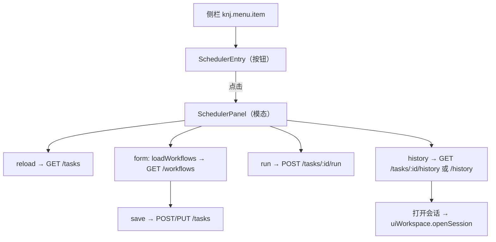
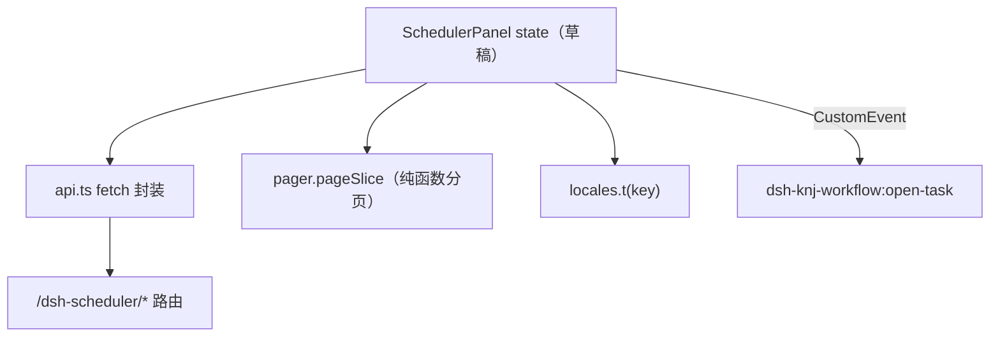

<details><summary>Relevant source files</summary>

- [src/client/index.ts](src/client/index.ts)
- [src/client/SchedulerEntry.tsx](src/client/SchedulerEntry.tsx)
- [src/client/SchedulerPanel.tsx](src/client/SchedulerPanel.tsx)
- [src/client/api.ts](src/client/api.ts)
- [src/client/pager.ts](src/client/pager.ts)
- [src/client/locales.ts](src/client/locales.ts)
- [test/client-session-nav.test.mjs](test/client-session-nav.test.mjs)

</details>

> 挖掘批次：2026-10-24 系统功能挖掘（wiki-capability）。本页是「界面面」：左侧栏入口如何注册、面板的四个视图与状态、表单校验的真实口径、以及会话导航的降级路径。

## 1. 概念定义

### 1.1 核心概念

| 概念 | 定义 | 为什么重要 |
|---|---|---|
| **slot 注册** | 客户端插件把「调度器」行注入 `knj.menu.item` 槽位，`id: 'dsh-scheduler'`、`order: 20`、`locale: 'zh'`（`src/client/index.ts:99-105`） | 入口不是路由，是宿主菜单槽；dsh-knj-menu 决定它显示在哪 |
| **SchedulerEntry** | 侧栏行组件：按钮 + 点击后渲染 `SchedulerPanel`（`src/client/SchedulerEntry.tsx:20-66`） | 面板不常驻，按需挂载；关闭即卸载 |
| **四个视图** | `View = 'list' | 'form' | 'history' | 'executions'`（`src/client/SchedulerPanel.tsx:17`） | 任务列表/表单/单任务历史/全量执行记录都在一个模态里切换 |
| **executionValid** | 保存按钮的「执行配置是否合法」判据（`src/client/SchedulerPanel.tsx:442-444`） | 它与后端校验口径不一致：这里**强制**工作流标题非空 |
| **迟到绑定** | `resolveUiWorkspace()` 在点击时读服务，而不是 apply 时捕获（`src/client/index.ts:82-86`） | 宿主服务可能晚于本插件注册；早绑定会拿到 undefined |

### 1.2 领域概念

| 术语 | 说明 |
|---|---|
| `knj.menu.item` | dsh-knj-menu 提供的侧栏菜单槽位名 |
| `dsw-alias-*` | 宿主设计 token；面板样式集中在 `T`/`S` 两个对象（`src/client/SchedulerPanel.tsx:34-132`） |
| `t(key)` | locale 绑定函数；`zh` 是键集事实源，`en` 必须同键（`src/client/locales.ts:5-101`、`src/client/locales.ts:105-201`） |
| 降级提示 | 导航服务缺失时把可见服务名拼进错误信息（`src/client/index.ts:89-97`） |

## 2. 系统事实

### 2.1 系统事实

| 事实 | 值 | 来源 |
|---|---|---|
| 客户端入口 | `ctx.slots.inject('knj.menu.item', () => ctx.slots.register({...}))` | `src/client/index.ts:101-104` |
| 注入的服务 | `locale`、`slots`、`sessions`、`workspaces`、`uiWorkspace` | `src/client/index.ts:69` |
| 词典 | 一次 `locale.register(NS, {zh, en})`，NS = `dsh-scheduler` | `src/client/index.ts:10`、`src/client/index.ts:72` |
| 打开/关闭 | 点击侧栏行 `setOpen(true)`；`Escape` 或点遮罩关闭 | `src/client/SchedulerEntry.tsx:21`、`src/client/SchedulerPanel.tsx:249-253`、`src/client/SchedulerPanel.tsx:463` |
| 保存按钮禁用条件 | `busy || name.trim()==='' || !executionValid || !triggerValid` | `src/client/SchedulerPanel.tsx:730` |
| `executionValid`（工作流） | `workflowId`、`workflowTitle`、`cwd` 均非空且必填文件入参已填 | `src/client/SchedulerPanel.tsx:442-444` |
| 附件上传 | 隐藏 `<input type=file multiple>` + 分块 base64 + `api.uploadAttachment` | `src/client/SchedulerPanel.tsx:301-344`、`src/client/SchedulerPanel.tsx:644-690` |
| 会话导航 | `uiWorkspace.openSession(id)`；先检查会话 cwd 是否属于已注册工作区 | `src/client/SchedulerPanel.tsx:212-235` |
| 分页 | 客户端切片，页大小 10/25/50/100，默认 25 | `src/client/pager.ts:6`、`src/client/SchedulerPanel.tsx:182-185` |
| fetch 封装 | 统一 `content-type: application/json`；非 2xx 抛 `body.error ?? HTTP <status>` | `src/client/api.ts:9-19` |

### 2.2 数据事实

| 数据 | 位置 / 形态 |
|---|---|
| 面板草稿状态 | React state：名称/类型/cron/runAt/everyMinutes/prompt/workflow*/附件/nextRun 等（`src/client/SchedulerPanel.tsx:144-186`） |
| 工作目录选项 | `workspaces.list.getSnapshot().items` 映射成 `{path,title}` 并按标题排序（`src/client/SchedulerPanel.tsx:191-196`） |
| 工作流声明的文件入参 | 从 `listWorkflows()` 结果里筛 `decl.type === 'file'`（`src/client/SchedulerPanel.tsx:440`） |
| 提交体 | `TaskInput`：按 executionKind/type 只挑对应字段，空路径不提交（`src/client/SchedulerPanel.tsx:370-405`） |
| 跨插件联动 | 通过 `window.dispatchEvent(new CustomEvent('dsh-knj-workflow:open-task', ...))` 交给 workflow 面板（`src/client/SchedulerPanel.tsx:484`、`src/client/SchedulerPanel.tsx:815`） |

## 3. 功能树与入口映射

### 3.1 功能模块结构

```
边栏面板与表单
├─ 插件装配 src/client/index.ts
│  ├─ locale.register(zh/en) + bind
│  ├─ slots.inject('knj.menu.item') → SchedulerEntry
│  └─ resolveUiWorkspace / describeContext（迟到绑定与诊断）
├─ 入口组件 src/client/SchedulerEntry.tsx
│  └─ 按钮（设计 token 样式）→ open 时挂 SchedulerPanel
├─ 面板 src/client/SchedulerPanel.tsx
│  ├─ 任务列表（list）：新建/刷新/编辑/启停/立即执行/历史/删除
│  ├─ 表单（form）：触发三型 + 执行类型 + 工作流字段 + 附件 + 路径入参 + 下次执行预览
│  ├─ 单任务历史（history）/ 全量执行记录（executions）：分页
│  └─ HistoryRow / Pager / HistoryRow 打开会话
└─ 支撑 src/client/{api,pager,locales}.ts
```

### 3.2 入口映射表

| 入口 | 类型 | 必填 | 内核 | 文件:行 |
|---|---|---|---|---|
| 侧栏「调度器」行 | ui（slot） | — | `SchedulerEntry` → `SchedulerPanel` | `src/client/index.ts:99-105` |
| 「新建任务」 | ui | 名称 + 触发 + 执行 | `openNew` → form → `save` | `src/client/SchedulerPanel.tsx:286-288`、`src/client/SchedulerPanel.tsx:370-405` |
| 「编辑」 | ui | — | `openEdit` 回填表单 | `src/client/SchedulerPanel.tsx:289-291` |
| 「立即执行」 | ui | — | `api.runTask` + runNotice | `src/client/SchedulerPanel.tsx:410-430` |
| 「打开会话」 | ui | `sessionId` | `uiWorkspace.openSession`（含工作区检查） | `src/client/SchedulerPanel.tsx:212-235` |
| 分页条 | ui | — | `pageSlice` + `Pager` | `src/client/SchedulerPanel.tsx:754-779` |

### 3.3 使用场景

| 场景 | 入口 | 理由 |
|---|---|---|
| 管理任务 | 任务列表页签 | 所有单任务操作（编辑/启停/执行/历史/删除）都在行内 |
| 配置新任务 | 表单 | 触发三型互斥渲染，执行类型切换决定显示 prompt 还是工作流字段 |
| 查跨任务执行 | 执行记录页签 | 全量历史 + 分页 + 打开产物 |
| 从执行记录跳回会话 | 行内「打开会话」 | 只有提示词任务有 sessionId；工作流任务给「查看流程任务」 |

## 4. 调用链路总结

### 4.1 主链路图



### 4.2 分通道详细流程

```
装配通道
  1. apply：注册词典并 bind t（src/client/index.ts:72-73）
  2. effect 注入 slots：register({name:'knj.menu.item', id:'dsh-scheduler', order:20, locale:'zh'}）（src/client/index.ts:101-103）
  3. 菜单渲染时创建 SchedulerEntry，把 t/sessions/workspaces/uiWorkspace/resolveUiWorkspace/describeContext 传下去（src/client/index.ts:103）

表单通道
  1. openNew 或 openEdit 重置/回填全部 state（src/client/SchedulerPanel.tsx:286-291）
  2. 输入触发字段时 preview effect 调 api.previewSchedule 更新 nextRun（src/client/SchedulerPanel.tsx:258-280）
  3. 切换执行类型到 knj-workflow 时 loadWorkflows（src/client/SchedulerPanel.tsx:282-285、src/client/SchedulerPanel.tsx:575）
  4. 保存：按 executionKind/type 组 TaskInput（空路径/空标题不提交），create 或 update，成功后 reload + 回列表（src/client/SchedulerPanel.tsx:370-405）
  5. 按钮可用性由 name/triggerValid/executionValid 共同决定（src/client/SchedulerPanel.tsx:730）

打开会话通道
  1. 点击时 resolveUiWorkspace() 取导航服务；undefined → 报错并附可见服务名（src/client/SchedulerPanel.tsx:212-219）
  2. 用 sessions.list 查会话 cwd；该 cwd 不在 workspaces 列表 → 「未注册工作区」提示（src/client/SchedulerPanel.tsx:220-228）
  3. nav.openSession(sessionId) 成功后 onClose；异常 → 「会话不存在或已被清理」（src/client/SchedulerPanel.tsx:229-234）
```

### 4.3 数据与存储关系



## 5. 附录

### 5.1 术语表

| 术语 | 含义 |
|---|---|
| slot | 宿主侧栏可注入的 UI 槽位 |
| 模态 | 覆盖全屏的 `overlay` + 居中面板，点遮罩关闭 |
| 行内操作 | 任务卡片上的编辑/启停/执行/历史/删除按钮 |
| `runNotice` | 立即执行成功后的绿色提示条（工作流任务带「查看流程任务」） |

> **两处口径不一致（静态）**：
> 1. **工作流标题到底能不能留空**：后端 `validateTaskInput` 不要求标题（`src/types.ts:156-165`），词典文案也写「可留空」（`src/client/locales.ts:48-49`），但前端 `executionValid` 要求 `workflowTitle.trim() !== ''`（`src/client/SchedulerPanel.tsx:443`），保存按钮因此不可用——UI 实际**不允许**留空。叠加加载白名单的问题（见 [[tasks-json-原子写入与加载白名单]]），三处口径需要统一。
> 2. **「跳过」状态**：UI 为它准备了文案与黄色时钟图标（`src/client/SchedulerPanel.tsx:791-797`），但没有任何写入路径，详见 [[capability-执行历史与状态流转]]。

### 5.2 参考资料

- [[capability-任务定义与持久化]] — 表单提交体对应的后端契约与校验
- [[capability-到点执行与提示词会话]] — 「立即执行」与 cron 触发的差异
- [[capability-附件与工作流联动]] — 表单里的附件与文件入参字段如何被消费

## 任务问法

```queries
边栏面板与表单是怎么实现的
调度器面板从哪里打开
保存按钮为什么是灰的
打开会话提示工作区未注册的原因
改面板表单要动哪些地方
新增一个表单字段要改哪些文件
```

## Sources

- `src/client/index.ts:71-105`（`apply`、`slots` 注入与 `SchedulerEntry`）
- `src/client/index.ts:40-54`（`UiWorkspaceService` 与 `WorkspacesService` 的子集契约）
- `src/client/SchedulerEntry.tsx:20-66`（入口组件与 `SchedulerPanel` 挂载）
- `src/client/SchedulerPanel.tsx:17-31`（`View` 四值与 `CRON_RE`）
- `src/client/SchedulerPanel.tsx:144-196`（面板 state 与 `cwdOptions`）
- `src/client/SchedulerPanel.tsx:370-405`（`save` 组提交体）
- `src/client/SchedulerPanel.tsx:437-444`（`CRON_RE`/`triggerValid`/`executionValid`）
- `src/client/api.ts:9-19`（`api` fetch 封装）
- `src/client/pager.ts:18-29`（`pageSlice` 与 `fmt`）
- `test/client-session-nav.test.mjs:26-58`（禁止 `sessions.open`、必须走 `uiWorkspace`）

```sources
[]
```
