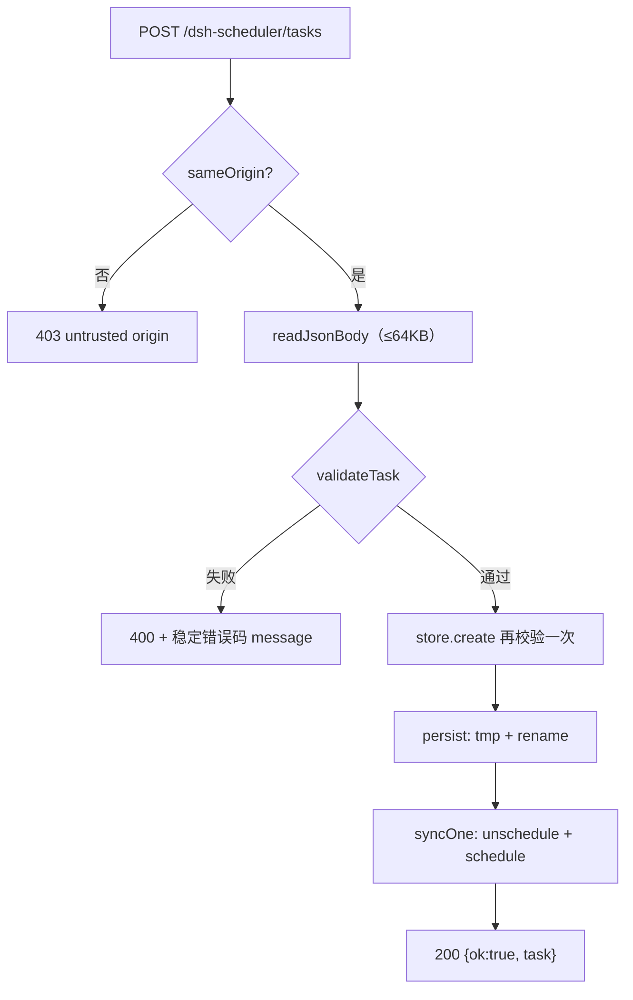
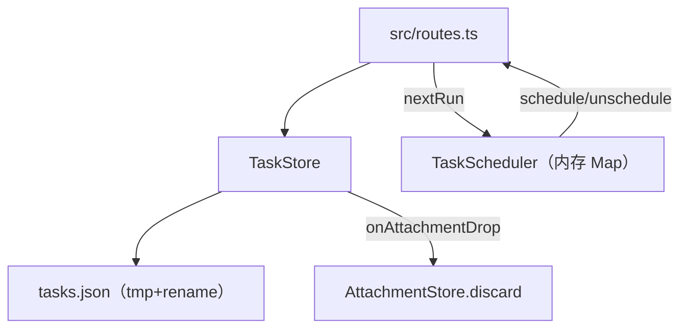

<details><summary>Relevant source files</summary>

- [src/routes.ts](src/routes.ts)
- [src/store.ts](src/store.ts)
- [src/types.ts](src/types.ts)
- [src/scheduler.ts](src/scheduler.ts)
- [src/client/api.ts](src/client/api.ts)

</details>

> 挖掘批次：2026-10-24 系统功能挖掘（wiki-capability）。只写有行号可核的代码事实；注释里的意图与代码行为冲突时，以代码为准并显式标注。

## 1. 概念定义

### 1.1 核心概念

| 概念 | 定义 | 为什么重要 |
|---|---|---|
| **TaskDef** | 持久化形态：`id`/`name`/`enabled`/`type`/`cron`|`runAt`|`everyMinutes`/`executionKind`/`prompt`|`workflow*`/`createdAt`/`updatedAt`（`src/types.ts:17-62`） | 路由、store、UI 三方的共同契约；字段形态一变，旧记录就可能过不了加载白名单 |
| **TaskInput** | 写入形态：全字段可选 + `enabled`，是 `validateTask` 的入参（`src/types.ts:64-89`） | 创建与编辑共用同一套校验；「留空」的语义在这里决定 |
| **effectiveType / effectiveExecutionKind** | 缺省归一化：type 非 once/interval 一律当 cron；executionKind 非 knj-workflow 一律当 prompt-session（`src/types.ts:190-192`、`src/types.ts:96-98`） | 老记录缺这两个字段也能读出来，不会因升级丢任务 |
| **原子写** | tmp 文件 + rename，Windows 上退避重试、最终原地覆盖（`src/store.ts:284-315`） | 写坏时保留旧文件；进程崩溃不留半截 JSON |

### 1.2 领域概念

| 术语 | 说明 |
|---|---|
| `executionKind` | `'prompt-session'` 或 `'knj-workflow'`，决定 executor 走哪条执行通道 |
| 触发类型 | `type: 'cron' | 'once' | 'interval'`，各自只带一个触发字段（`cron` / `runAt` / `everyMinutes`） |
| `workflowPathInputs` | 「参数名 → 路径」映射，只校验形状、不校验文件是否存在（`src/types.ts:128-146`） |
| `workflowAttachments` | 调度器自己持久化的附件快照引用，切回提示词任务时清空并回收（见 [[capability-附件与工作流联动]]） |

## 2. 系统事实

### 2.1 系统事实

| 事实 | 值 | 来源 |
|---|---|---|
| 数据目录默认值 | `$DSH_HOME/profiles/<profile>/dsh-scheduler`，可用 Config `dataDir` 覆盖 | `src/index.ts:55-59`、`src/index.ts:27` |
| 任务文件名 | `tasks.json` | `src/store.ts:11` |
| 任务文件形态 | `{ version: 1, tasks: TaskDef[] }`，缩进 2 空格的 JSON | `src/store.ts:285-286` |
| 执行历史文件名 | `history.jsonl`（逐行 JSON） | `src/store.ts:12` |
| 历史保留上限 | 构造参数 `historyRetention`，插件默认 500 | `src/index.ts:28`、`src/store.ts:43-46` |
| 请求体上限 | `MAX_BODY_BYTES = 64 * 1024` | `src/routes.ts:32` |
| 写路由鉴权 | `sameOrigin`：Origin 与 Host 不同源则 403；缺 Origin（curl/同源导航）放行 | `src/routes.ts:264-274` |
| 校验入口 | `validateTask` = `validateTaskInput`（执行字段）+ 按 type 的触发字段校验 | `src/types.ts:195-216` |

### 2.2 数据事实

| 数据 | 位置 / 形态 |
|---|---|
| 任务定义 | `<dataDir>/tasks.json`，JSON `{version,tasks}`，原子写覆盖 |
| 执行历史 | `<dataDir>/history.jsonl`，append-only + 每次 append 后裁剪 |
| 附件文件 | `<dataDir>/attachments/<uploadId>/<name>`，跨触发存活 |
| 删除任务的副作用 | `store.remove` 先 persist，再把其 `workflowAttachments` 的 uploadId 交给 `onAttachmentDrop` 回收（`src/store.ts:166-176`） |

## 3. 功能树与入口映射

### 3.1 功能模块结构

```
任务定义与持久化
├─ HTTP 层 src/routes.ts
│  ├─ GET  /dsh-scheduler/tasks        ← 列表 + 每条 nextRun
│  ├─ POST /dsh-scheduler/tasks        ← 创建（校验 + store.create + syncOne）
│  ├─ PUT  /dsh-scheduler/tasks/:id    ← 编辑（校验 + store.update + syncOne）
│  └─ DELETE /dsh-scheduler/tasks/:id  ← 删除（store.remove + unschedule）
├─ 校验 src/types.ts
│  ├─ validateTask → validateTaskInput（执行字段）
│  └─ 按 type 校验 cron / runAt / everyMinutes
└─ 持久化 src/store.ts
   ├─ create / update / remove / setEnabled  ← 每次变更都 persist()
   └─ persist → tmp + rename（EPERM/EACCES/EBUSY 退避重试）
```

### 3.2 入口映射表

| 入口 | 类型 | 必填 | 内核 | 文件:行 |
|---|---|---|---|---|
| `GET /dsh-scheduler/tasks` | route | — | `store.list()` + `scheduler.nextRun()` 拼 `nextRun` | `src/routes.ts:133-139` |
| `POST /dsh-scheduler/tasks` | route | `name`、触发字段、执行字段 | `validateTask` → `store.create` → `syncOne` | `src/routes.ts:141-151` |
| `PUT /dsh-scheduler/tasks/:id` | route | 同 POST | `validateTask` → `store.update` → `syncOne` | `src/routes.ts:200-210` |
| `DELETE /dsh-scheduler/tasks/:id` | route | — | `store.remove` → `scheduler.unschedule` | `src/routes.ts:211-218` |
| `api.createTask / updateTask / deleteTask` | ui | — | fetch 封装，错误取响应体 `error` | `src/client/api.ts:94-104` |

### 3.3 使用场景

| 场景 | 入口 | 理由 |
|---|---|---|
| 在面板里新建一个定时任务 | `POST /tasks` | 只有它做完整校验并排期；其他写入口都复用同一校验 |
| 改触发时间/提示词 | `PUT /tasks/:id` | 走同一校验，`syncOne` 会先撤旧 job 再按 enabled 重排 |
| 改启用状态 | `POST /tasks/:id/toggle` | 比 PUT 少传整个任务体，避免误改其他字段 |
| 删掉任务且回收附件 | `DELETE /tasks/:id` | `store.remove` 内部触发 `onAttachmentDrop`，删完 unschedule |

## 4. 调用链路总结

### 4.1 主链路图



### 4.2 分通道详细流程

```
POST /dsh-scheduler/tasks
  1. sameOrigin 失败 → 403（src/routes.ts:142）
  2. readJsonBody：超过 64KB → 413 PAYLOAD_TOO_LARGE；非法 JSON → 400 BAD_JSON（src/routes.ts:276-298）
  3. validateTask(body)（src/routes.ts:144）
       a. validateTaskInput：name 必填；knj-workflow 需 workflowId + cwd；prompt-session 需 prompt；
          workflowPathInputs / workflowAttachments 只做形状校验（src/types.ts:148-175）
       b. 按 effectiveType 校验触发字段：cron 可解析 / runAt 是合法日期 / everyMinutes 是 ≥1 整数（src/types.ts:195-216）
  4. store.create 内部**再次** validateTask（store 不信任调用方），失败返回 null → 400（src/store.ts:88-90）
  5. persist() 原子写（src/store.ts:116）
  6. syncOne(task)：先 unschedule 再按 enabled 排期（src/routes.ts:148）

PUT /dsh-scheduler/tasks/:id
  1-4 同上；store.update 额外做字段归一化，并把被替换/清除的附件 uploadId 交给 onAttachmentDrop（src/store.ts:134-159）
  5. 记录不存在 → 404（src/routes.ts:206）

DELETE /dsh-scheduler/tasks/:id
  1. sameOrigin → 2. store.remove(id)（内部 persist + 回收附件）→ 3. scheduler.unschedule → 200
```

### 4.3 数据与存储关系



## 5. 附录

### 5.1 术语表

| 术语 | 含义 |
|---|---|
| `dataDir` | 调度器数据目录，默认在 profile 下，可用插件 Config 覆盖 |
| `syncOne` / `syncAll` | store 到 scheduler 的两个同步原语：单任务重排 / 全量重排 |
| 孤儿附件 | 编辑或删除任务后不再被任何任务引用的 `uploadId` |
| `ValidateResult` | `{ok:true}` 或 `{ok:false, code, message}`，`code` 是稳定机器码（`src/types.ts:91-93`） |

### 5.2 参考资料

- [[tasks-json-原子写入与加载白名单]] — `persist` 的重试细节，以及 `isTaskDef` 白名单会静默丢弃无标题工作流任务的推断
- [[croner-protect-与非重入触发]] — 为什么保存成功也可能永不触发（`schedule` 返回 false 无人检查）
- [[capability-触发计划与下次执行]] — `syncOne` 之后 job 表如何变化

## 任务问法

```queries
任务定义与持久化是怎么实现的
tasks.json 存在哪里，写坏了怎么办
调度器重启后任务还在吗，记录为什么会消失
创建任务时后端做了哪些校验
改任务字段要动哪些地方
新增一种触发类型要改哪些文件
```

## Sources

- `src/types.ts:17-62`（`TaskDef` 持久化字段全集）
- `src/types.ts:148-175`（`validateTaskInput` 执行字段校验）
- `src/types.ts:195-216`（`validateTask` 按 type 分支）
- `src/store.ts:88-118`（`create` 构造 TaskDef 并 persist）
- `src/store.ts:121-164`（`update` 归一化与孤儿附件回收）
- `src/store.ts:284-291`（`persist` 的 tmp + rename）
- `src/routes.ts:132-154`（tasks 路由 GET/POST）
- `src/routes.ts:199-221`（`/tasks/:id` 的 PUT/DELETE）
- `src/routes.ts:276-298`（`readJsonBody` 与 413/400 错误码）

```sources
[
  {
    "path": "src/types.ts",
    "hash": "sha256:d99ba0a7969549d8",
    "symbols": [
      "TaskDef",
      "TaskInput",
      "validateTask",
      "validateTaskInput"
    ]
  },
  {
    "path": "src/store.ts",
    "hash": "sha256:2bf1c3853a5aa862",
    "symbols": [
      "TaskStore",
      "create",
      "update",
      "remove",
      "persist"
    ]
  },
  {
    "path": "src/routes.ts",
    "hash": "sha256:a68da25aa3b41011",
    "symbols": [
      "mountSchedulerRoutes",
      "validateTask",
      "readJsonBody"
    ]
  },
  {
    "path": "src/scheduler.ts",
    "hash": "sha256:da7e59a381cc42cc",
    "symbols": [
      "TaskScheduler",
      "nextRun"
    ]
  },
  {
    "path": "src/client/api.ts",
    "hash": "sha256:7314cd0dcc0b7a29",
    "symbols": [
      "createTask",
      "updateTask",
      "deleteTask"
    ]
  }
]
```
