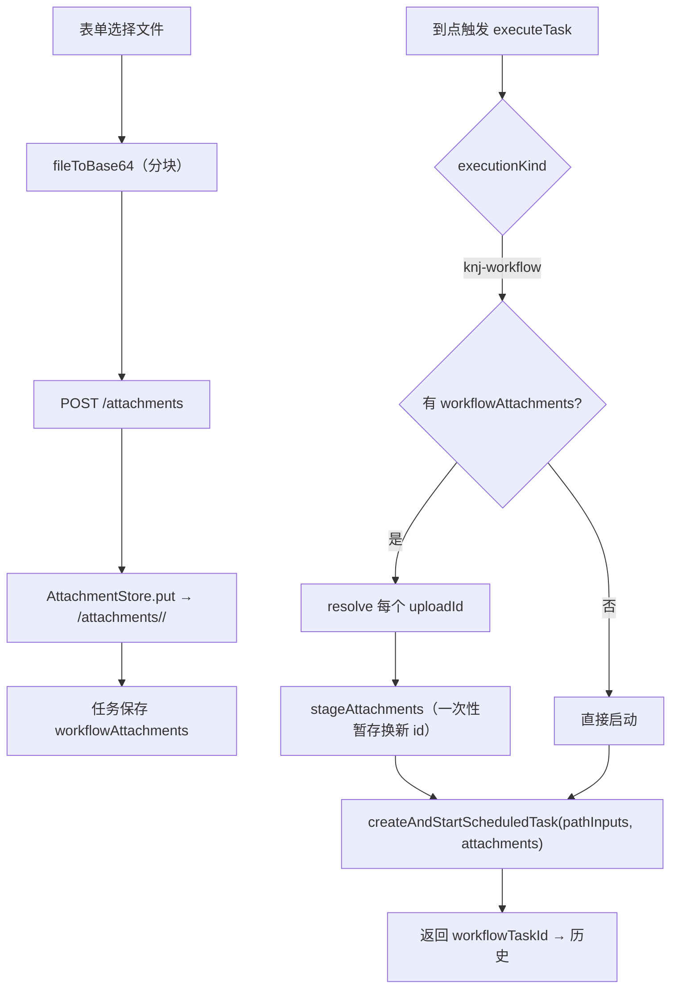
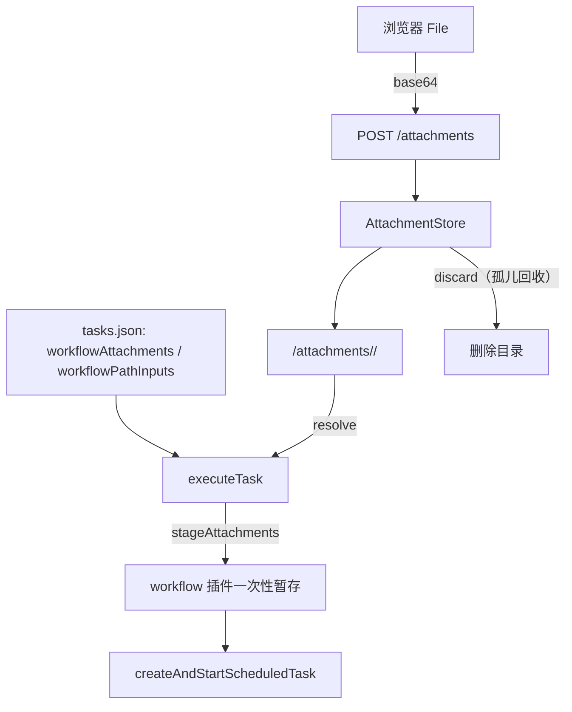

<details><summary>Relevant source files</summary>

- [src/attachments.ts](src/attachments.ts)
- [src/executor.ts](src/executor.ts)
- [src/routes.ts](src/routes.ts)
- [src/types.ts](src/types.ts)
- [src/index.ts](src/index.ts)
- [src/client/SchedulerPanel.tsx](src/client/SchedulerPanel.tsx)

</details>

> 挖掘批次：2026-10-24 系统功能挖掘（wiki-capability）。本页覆盖两件事：**KNJ 工作流任务怎么启动**，以及**文件怎么从浏览器交到流程里**（两条互不替代的通道：附件快照 vs 路径引用）。

## 1. 概念定义

### 1.1 核心概念

| 概念 | 定义 | 为什么重要 |
|---|---|---|
| **workflowAttachments（快照）** | 浏览器上传的文件存在调度器自己的目录 `<dataDir>/attachments/<uploadId>/<name>`，每次触发都用这份字节（`src/attachments.ts:1-18`、`src/types.ts:50-59`） | 适用「文件在 workspace 之外」；替换/删除任务时要回收，否则目录永久积攒孤儿 |
| **workflowPathInputs（路径）** | 「参数名 → 路径」映射，**触发时才读**；相对路径由 workflow 插件按任务 cwd 解析，缺文件让本次启动失败（`src/types.ts:44-49`） | 适用「文件由别的流程产出、每次要最新」；调度器不校验存在性 |
| **stageAttachments** | 每次触发前，把调度器持久化的文件重新放进 workflow 插件的一次性暂存区，换一批新 `uploadId`（`src/executor.ts:124-144`） | 不做这步，第二次触发会因「暂存已失效」失败 |
| **createAndStartScheduledTask** | workflow 插件暴露的启动接口，调度器只调用它、**不等待也不镜像**流程最终状态（`src/executor.ts:23-44`、`src/executor.ts:145-157`） | 历史里只有「已成功启动/启动失败」，详细状态要去流程运行看 |

### 1.2 领域概念

| 术语 | 说明 |
|---|---|
| `uploadId` | 附件目录名，形态 `att-<base36 时间>-<8 位随机>`，受 `ID_RE` 约束（`src/attachments.ts:40`、`src/attachments.ts:146`） |
| 一次性暂存 | workflow 插件的上传暂存区：被本次运行消费即失效、24h 清理（`src/attachments.ts:3-9`） |
| 附件上限 | 单文件 32MB（`MAX_ATTACHMENT_BYTES`）、20 个（`MAX_ATTACHMENTS`）、上传请求体 `ATTACHMENT_BODY_BYTES` ≈ 44MB（`src/attachments.ts:33-38`） |
| `stageAttachments` 缺失 | 老版本 workflow 插件没有该方法 → 本次执行直接 failed，并提示更新插件（`src/executor.ts:132-134`） |

## 2. 系统事实

### 2.1 系统事实

| 事实 | 值 | 来源 |
|---|---|---|
| 附件上传入口 | `POST /dsh-scheduler/attachments`，body 上限 `ATTACHMENT_BODY_BYTES` | `src/routes.ts:113-120` |
| 建任务 body 上限 | 64KB（`MAX_BODY_BYTES`），所以附件必须走独立上传路由 | `src/routes.ts:32`、`src/routes.ts:111-113` |
| 工作流列表入口 | `GET /dsh-scheduler/workflows`，要求 `ctx.get('knjWorkflowScheduler').listWorkflows` | `src/routes.ts:122-130` |
| 服务缺失语义 | workflows 列表 503；执行时 503 语义改成 failed 结果 | `src/routes.ts:124-127`、`src/executor.ts:120-123` |
| 附件仅工作流任务可用 | `describeWorkflowAttachmentsError` 在 prompt-session 上返回「附件只适用于 KNJ 工作流任务」 | `src/attachments.ts:101-104` |
| 路径入参仅工作流任务可用 | `describeWorkflowPathInputsError` 同理 | `src/types.ts:142-144` |
| 文件名清洗 | `sanitizeAttachmentName`：取 basename、去非法字符、去首尾空白/点、截断到 120 字符并保留扩展名 | `src/attachments.ts:49-62` |
| 切回提示词任务 | `store.update` 清空 `workflowAttachments` 并把 uploadId 交给 `onAttachmentDrop` 回收 | `src/store.ts:135-144` |
| 附件存储接线 | `apply` 里 `AttachmentStore(join(dataDir,'attachments'))` + `store.onAttachmentDrop` → `attachments.discard` | `src/index.ts:30-38` |

### 2.2 数据事实

| 数据 | 位置 / 形态 |
|---|---|
| 附件文件 | `<dataDir>/attachments/<uploadId>/<name>`，跨触发存活，无 TTL |
| 任务上的附件引用 | `tasks.json` 的 `workflowAttachments: {uploadId,name,size?}[]` |
| 任务上的路径入参 | `tasks.json` 的 `workflowPathInputs: Record<string,string>` |
| 本次触发的附件引用 | 不落库：`stageAttachments` 每次返回新 `{uploadId,name,size}`，只活在这次 `createAndStartScheduledTask` 调用里 |
| 未用到的能力 | `materialize()` 与 `discardUnreferenced()` 在 `src` 内没有调用点（`src/attachments.ts:152-185`），属预留/待接线的清理能力 |

## 3. 功能树与入口映射

### 3.1 功能模块结构

```
附件与工作流联动
├─ 附件存储 src/attachments.ts
│  ├─ AttachmentStore.put/resolve   ← 上传与解析
│  ├─ discard（被 store.onAttachmentDrop 调用）← 回收孤儿
│  └─ sanitize / normalize / describeError
├─ HTTP 层 src/routes.ts
│  ├─ POST /dsh-scheduler/attachments  ← 上传（sameOrigin + 独立 body 上限）
│  └─ GET  /dsh-scheduler/workflows    ← 列出已保存工作流
├─ 执行器 src/executor.ts
│  ├─ 工作流分支 → createAndStartScheduledTask
│  └─ 附件分支 → resolve → stageAttachments → 传 attachments/attachmentsAreReusable
└─ 前端 src/client/SchedulerPanel.tsx
   ├─ 工作流下拉（loadWorkflows）
   ├─ 附件选择→base64→uploadAttachment
   └─ 文件入参路径字段（按工作流声明渲染）
```

### 3.2 入口映射表

| 入口 | 类型 | 必填 | 内核 | 文件:行 |
|---|---|---|---|---|
| `POST /dsh-scheduler/attachments` | route | `name` + `dataBase64` | `AttachmentStore.put` | `src/routes.ts:113-120` |
| `GET /dsh-scheduler/workflows` | route | — | `knjWorkflowScheduler.listWorkflows` | `src/routes.ts:122-130` |
| `executeTask`（workflow 分支） | internal | `workflowId` + `cwd` | `stageAttachments` → `createAndStartScheduledTask` | `src/executor.ts:119-158` |
| 表单「选择文件」 | ui | — | `fileToBase64` → `api.uploadAttachment` | `src/client/SchedulerPanel.tsx:301-344` |
| 表单「文件入参」路径字段 | ui | 按声明（`required` 标 `*`） | `workflowPathInputs[decl.name]` | `src/client/SchedulerPanel.tsx:691-710` |

### 3.3 使用场景

| 场景 | 入口 | 理由 |
|---|---|---|
| 把本地文档交给每次定时流程 | 附件上传 | 快照语义：每次触发字节都一样，文件在哪都行 |
| 引用「由别的流程今天产出」的文件 | 文件入参路径 | 触发时才读，永远拿最新；缺文件让本次失败并留错误 |
| 只想看有哪些工作流可选 | `GET /workflows` | 静态列表；切换执行类型时前端才拉取 |
| 任务从工作流改回提示词 | `PUT /tasks/:id` | 附件字段被清空并回收，避免孤儿 |

## 4. 调用链路总结

### 4.1 主链路图



### 4.2 分通道详细流程

```
上传通道
  1. sameOrigin 校验（失败 403）；附件存储不可用 → 503（src/routes.ts:114-115）
  2. readJsonBody(request, ATTACHMENT_BODY_BYTES)（src/routes.ts:116）
  3. attachments.put({name, dataBase64})：
       - sanitizeAttachmentName 不合法 → 抛可读错误（src/attachments.ts:135-136）
       - base64 形状校验 → 解码 → 空文件/超 32MB 拒绝（src/attachments.ts:137-145）
       - 生成 uploadId、mkdir、写文件（src/attachments.ts:146-149）
  4. 返回 {uploadId, name, size}，前端追加到 workflowAttachments 列表

触发通道（workflow 分支）
  1. ctx.get('knjWorkflowScheduler')，无 createAndStartScheduledTask → failed（src/executor.ts:120-123）
  2. refs = task.workflowAttachments；有 annex 时：
       a. 附件存储不可用 → failed（src/executor.ts:129-131）
       b. 插件缺 stageAttachments → failed 并提示更新（src/executor.ts:132-134）
       c. 逐个 resolve；任一丢失 → failed「附件已丢失：<名>（<id>），请重新选择文件」（src/executor.ts:136-141）
       d. stageAttachments({files}) 换取本次的新 uploadId（src/executor.ts:143）
  3. createAndStartScheduledTask({ workflowId, title?, description?, storyCode, cwd,
       pathInputs?, attachments?, attachmentsAreReusable: true })（src/executor.ts:145-156）
  4. 返回 {status:'created', workflowTaskId}（src/executor.ts:157）

回收通道
  1. store.update 切换执行类型或替换附件 → orphaned uploadIds（src/store.ts:134-159）
  2. store.remove 删除任务 → 该任务所有附件 uploadId（src/store.ts:166-176）
  3. onAttachmentDrop → attachments.discard(id)，best-effort 失败不影响保存/删除（src/index.ts:32-38）
```

### 4.3 数据与存储关系



## 5. 附录

### 5.1 术语表

| 术语 | 含义 |
|---|---|
| 快照 | 调度器存字节；每次触发同一份内容 |
| 路径引用 | 只存路径字符串；触发时才读文件 |
| `attachmentsAreReusable` | 告诉 workflow 插件「这批附件是调度器所有，别在本次消费后丢掉」 |
| 孤儿附件 | 已不被任何任务引用的 `uploadId` |

### 5.2 参考资料

- [[capability-到点执行与提示词会话]] — 同一个 `executeTask` 的另一条分支，以及历史 `running→终态` 的写入点
- [[capability-任务定义与持久化]] — `workflowPathInputs` / `workflowAttachments` 的校验与归一化入口
- [[tasks-json-原子写入与加载白名单]] — 为什么「附件丢失」类错误只会出现在触发时而不是保存时

## 任务问法

```queries
附件与工作流联动是怎么实现的
调度器的附件存在哪里，什么时候会被删除
附件快照和路径引用有什么区别
附件暂存失效后怎么处理
工作流任务启动失败怎么排查
新增一种文件入参要改哪些地方
```

## Sources

- `src/attachments.ts:24-38`（`WorkflowAttachmentRef` 与三个上限常量）
- `src/attachments.ts:49-78`（`sanitizeAttachmentName` 与 `normalizeWorkflowAttachments`）
- `src/attachments.ts:108-150`（`AttachmentStore` 的 `resolve` 与 `put`）
- `src/attachments.ts:152-185`（`materialize`/`discard`/`discardUnreferenced`）
- `src/executor.ts:119-158`（workflow 分支与 `stageAttachments`）
- `src/routes.ts:111-130`（`attachments` 与 `workflows` 两条路由）
- `src/types.ts:44-59`（`workflowPathInputs` 与 `workflowAttachments` 字段语义）
- `src/types.ts:128-146`（`describeWorkflowPathInputsError` 形状校验）
- `src/index.ts:30-38`（附件存储与 `onAttachmentDrop` 接线）
- `src/client/SchedulerPanel.tsx:301-344`（`fileToBase64` 与 `uploadAttachments`）

```sources
[
  {
    "path": "src/attachments.ts",
    "hash": "sha256:3a1b1b259ab6b7db",
    "symbols": [
      "WorkflowAttachmentRef",
      "AttachmentStore",
      "sanitizeAttachmentName",
      "normalizeWorkflowAttachments",
      "MAX_ATTACHMENT_BYTES"
    ]
  },
  {
    "path": "src/executor.ts",
    "hash": "sha256:7e1b374ad982d35b",
    "symbols": [
      "executeTask",
      "stageAttachments",
      "createAndStartScheduledTask"
    ]
  },
  {
    "path": "src/routes.ts",
    "hash": "sha256:a68da25aa3b41011",
    "symbols": [
      "attachments",
      "workflows",
      "ATTACHMENT_BODY_BYTES"
    ]
  },
  {
    "path": "src/types.ts",
    "hash": "sha256:d99ba0a7969549d8",
    "symbols": [
      "workflowPathInputs",
      "workflowAttachments",
      "describeWorkflowPathInputsError"
    ]
  },
  {
    "path": "src/index.ts",
    "hash": "sha256:fa30cb84eaed8e50",
    "symbols": [
      "AttachmentStore",
      "onAttachmentDrop"
    ]
  },
  {
    "path": "src/client/SchedulerPanel.tsx",
    "hash": "sha256:e509e15f1230ea65",
    "symbols": [
      "fileToBase64",
      "uploadAttachments",
      "workflowPathInputs"
    ]
  }
]
```
