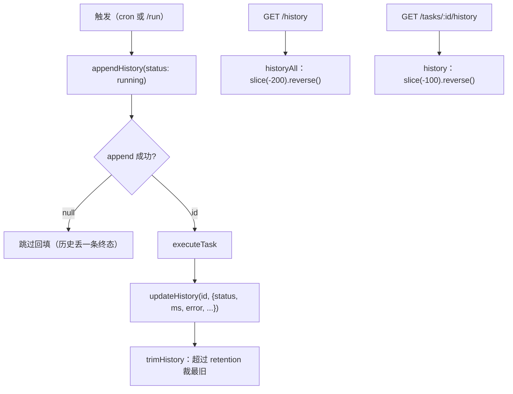
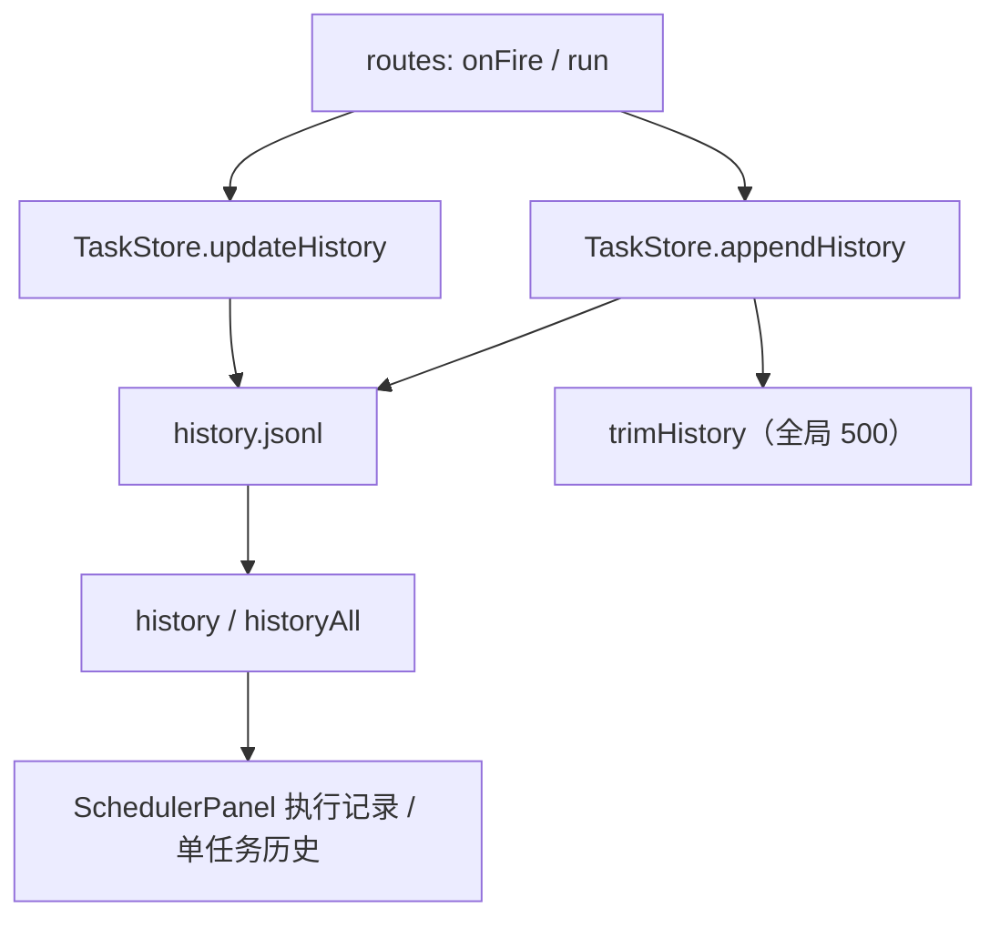

<details><summary>Relevant source files</summary>

- [src/store.ts](src/store.ts)
- [src/routes.ts](src/routes.ts)
- [src/client/SchedulerPanel.tsx](src/client/SchedulerPanel.tsx)
- [src/client/pager.ts](src/client/pager.ts)
- [src/client/locales.ts](src/client/locales.ts)

</details>

> 挖掘批次：2026-10-24 系统功能挖掘（wiki-capability）。本页只写「历史记录」这一面；触发与执行内核分别在 [[capability-触发计划与下次执行]] 与 [[capability-到点执行与提示词会话]]。

## 1. 概念定义

### 1.1 核心概念

| 概念 | 定义 | 为什么重要 |
|---|---|---|
| **HistoryEntry** | 一条执行记录：`id?`/`taskId`/`at`/`status`/`sessionId?`/`workflowTaskId?`/`ms?`/`error?`（`src/store.ts:16-26`） | 它是 UI 唯一的执行事实来源；提示词原文不落这里 |
| **running → 终态回填** | 触发时先 append 一条 `running` 并拿到 `id`，执行结束用 `updateHistory(id, patch)` 原地改这一行（`src/store.ts:193-203`、`src/store.ts:206-229`） | 长跑任务在历史里是「执行中」；进程崩溃会永久留下 running 行 |
| **保留上限** | `historyRetention` 默认 500，按**全库总行数**裁剪，不是按任务（`src/store.ts:43-46`、`src/store.ts:270-281`） | UI 文案写「500 条/任务」，与实现口径不一致 |
| **读取上限** | 单任务 `history(id, limit=100)`；全量 `historyAll(limit=200)`；都返回最新在前（`src/store.ts:231-248`、`src/store.ts:251-268`） | 路由没有分页参数，分页完全在前端做 |

### 1.2 领域概念

| 术语 | 说明 |
|---|---|
| `status` 四值 | `'running' | 'created' | 'failed' | 'skipped'`（`src/store.ts:14`） |
| `skipped` 的实际状态 | **代码里没有任何写入点**：`onFire` 只写 `running` 再回填 `created`/`failed`（`src/routes.ts:43-53`）；UI 却为它准备了文案与图标（`src/client/SchedulerPanel.tsx:791-797`） |
| `id` | append 时生成（缺省 `randomId()`），只有它能把 running 翻成终态（`src/store.ts:194`、`src/store.ts:217`） |
| 客户端分页 | `pageSlice(items, page, pageSize)` + `PAGE_SIZES = [10,25,50,100]`（`src/client/pager.ts:6`、`src/client/pager.ts:18-24`） |

## 2. 系统事实

### 2.1 系统事实

| 事实 | 值 | 来源 |
|---|---|---|
| 历史文件 | `<dataDir>/history.jsonl`，一行一条 JSON | `src/store.ts:12` |
| 写入方式 | `writeFileSync(..., { flag: 'a' })` 追加，然后立刻 `trimHistory()` | `src/store.ts:196-197` |
| 回填方式 | 读出全文件 → 逐行 parse → 命中 id 的行替换 → 整文件 `writeFileSync` 重写 | `src/store.ts:210-225` |
| 回填找不到行 | 静默返回，不报错 | `src/store.ts:224` |
| 写入失败 | `appendHistory` 捕获异常返回 `null`；调用方跳过后续 `updateHistory` | `src/store.ts:199-202`、`src/routes.ts:45` |
| 全量历史接口 | `GET /dsh-scheduler/history` → `store.historyAll()`（固定 200） | `src/routes.ts:106-109` |
| 单任务历史接口 | `GET /dsh-scheduler/tasks/:id/history` → `store.history(id)`（固定 100） | `src/routes.ts:191-197` |
| 前端默认页大小 | 执行记录 25、单任务历史 25（可选 10/50/100） | `src/client/SchedulerPanel.tsx:182-185` |

### 2.2 数据事实

| 数据 | 位置 / 形态 |
|---|---|
| 历史行 | `<dataDir>/history.jsonl`，JSONL，append + 全文件裁剪/重写 |
| 回填的整文件重写 | 非原子：直接 `writeFileSync(file, ...)`，没有 tmp+rename（对比 `tasks.json` 见 [[tasks-json-原子写入与加载白名单]]） |
| 任务名映射 | 执行记录页用 `taskNameById` 把 `taskId` 换成任务名，找不到就显示 id 前 8 位（`src/client/SchedulerPanel.tsx:188`、`src/client/SchedulerPanel.tsx:547`） |
| 打开产物 | 提示词任务给「打开会话」（`sessionId`）；工作流任务给「查看流程任务」（`workflowTaskId`，通过 CustomEvent 交给 workflow 面板）（`src/client/SchedulerPanel.tsx:811-828`、`src/client/SchedulerPanel.tsx:484`） |
| 保留文案 | 单任务页写「保留上限 500 条/任务」，全量页写「保留上限 500 条」（`src/client/locales.ts:81-88`） |

## 3. 功能树与入口映射

### 3.1 功能模块结构

```
执行历史与状态流转
├─ 存储 src/store.ts
│  ├─ appendHistory   ← 追加 running，返回 id
│  ├─ updateHistory   ← 按 id 翻转终态（整文件重写）
│  ├─ trimHistory     ← 超过 retention 裁掉最旧
│  ├─ history(taskId) ← 单任务，最新在前，上限 100
│  └─ historyAll()    ← 全任务，最新在前，上限 200
├─ 路由 src/routes.ts
│  ├─ GET /dsh-scheduler/history
│  └─ GET /dsh-scheduler/tasks/:id/history
└─ UI src/client/SchedulerPanel.tsx
   ├─ 执行记录页（全量 + 分页）
   ├─ 单任务历史页（分页 + 返回）
   └─ HistoryRow：状态图标/文案/耗时/打开入口
```

### 3.2 入口映射表

| 入口 | 类型 | 必填 | 内核 | 文件:行 |
|---|---|---|---|---|
| `GET /dsh-scheduler/history` | route | — | `store.historyAll()` | `src/routes.ts:106-109` |
| `GET /dsh-scheduler/tasks/:id/history` | route | 任务 id | `store.history(id)` | `src/routes.ts:191-197` |
| 「执行记录」页签 | ui | — | `api.listHistory` → `pageSlice` | `src/client/SchedulerPanel.tsx:532-553` |
| 任务行「历史」按钮 | ui | — | `api.taskHistory` | `src/client/SchedulerPanel.tsx:345-354` |
| 回填（内部） | internal | entry id | `store.updateHistory` | `src/routes.ts:46-53` |

### 3.3 使用场景

| 场景 | 入口 | 理由 |
|---|---|---|
| 想知道最近所有任务的执行结果 | 执行记录页 | 跨任务、按时间倒序，能看到失败原因 |
| 只看某一个任务跑了什么 | 任务行「历史」 | 服务端已按 `taskId` 过滤 |
| 从历史跳回产出 | 「打开会话」/「查看流程任务」 | 历史里存了 `sessionId` / `workflowTaskId` |
| 想知道任务卡在「执行中」 | 执行记录页 | 只有进程中途崩溃才会出现，见附录 |

## 4. 调用链路总结

### 4.1 主链路图



### 4.2 分通道详细流程

```
写入通道（每次触发）
  1. appendHistory({taskId, at, status:'running'})（src/routes.ts:43、src/routes.ts:176）
  2. 生成 id 并追加到 history.jsonl（src/store.ts:194-196）
  3. trimHistory：行数 > retention 时只保留最后 N 行（src/store.ts:270-281）
  4. 执行结束 updateHistory(id, patch)：
       读全文件 → 逐行 JSON.parse → id 命中则合并 patch → 整文件重写（src/store.ts:210-225）

读取通道
  1. 全量：historyAll() 过滤掉 taskId 非 string 的行，slice(-200).reverse()（src/store.ts:251-268）
  2. 单任务：history(taskId) 过滤等值，slice(-100).reverse()（src/store.ts:231-248）
  3. 坏行/无法 parse 的行：跳过，不影响其他行（src/store.ts:237-243）

UI 通道
  1. 执行记录：reloadExecutions → setAllHistory → pageSlice → HistoryRow（src/client/SchedulerPanel.tsx:356-369）
  2. 单任务：openHistory → setHistory → setView('history')（src/client/SchedulerPanel.tsx:345-354）
  3. 分页条固定在面板底部，翻页时 scrollTop（src/client/SchedulerPanel.tsx:754-779）
```

### 4.3 数据与存储关系



## 5. 附录

### 5.1 术语表

| 术语 | 含义 |
|---|---|
| `running` | 触发已记录但执行未结束；崩溃后不会自愈 |
| `created` | 会话或流程任务已成功创建（不是模型答完） |
| `ms` | 执行耗时，只覆盖 `executeTask` 内的耗时 |
| 全量历史 | 跨任务、最近 200 行 |

> **两处静态推导（需按部署验证）**：
> 1. **「跳过」状态不可达**：`HistoryStatus` 定义 `skipped`（`src/store.ts:14`），UI 也渲染它（`src/client/SchedulerPanel.tsx:791-797`），但仓库内没有写入 `skipped` 的代码路径——croner 的 `protect` 丢弃触发时不会留下任何历史行。也就是说「防重入跳过」在历史里是看不到的，`running` 卡住只能靠人工判断或看宿主会话。
> 2. **running 行不会自动收敛**：`updateHistory` 只在 `executeTask` 返回后调用；插件进程若在执行中途退出，这一行会永久保持 `running`，`trimHistory` 只按行数裁剪，不会按时间清理。

### 5.2 参考资料

- [[capability-到点执行与提示词会话]] — `running` 行的写入方与终态回填的调用点
- [[capability-任务定义与持久化]] — 同一个 store 里 `tasks.json` 的原子写对照
- [[tasks-json-原子写入与加载白名单]] — 为什么历史回填没有沿用 tmp+rename

## 任务问法

```queries
执行历史与状态流转是怎么实现的
执行历史存在哪里，最多保留多少条
执行记录里一直显示执行中的原因
为什么历史里看不到跳过状态
历史记录的分页和上限是怎么算的
改历史状态字段要动哪些地方
```

## Sources

- `src/store.ts:14-26`（`HistoryStatus` 与 `HistoryEntry`）
- `src/store.ts:193-203`（`appendHistory`）
- `src/store.ts:206-229`（`updateHistory` 整文件回填）
- `src/store.ts:231-248`（`history` 单任务读取）
- `src/store.ts:251-268`（`historyAll` 全量读取）
- `src/store.ts:270-281`（`trimHistory` 全局裁剪）
- `src/routes.ts:106-109`（`historyAll` 路由）
- `src/routes.ts:191-197`（`historyMatch` 单任务历史路由）
- `src/client/SchedulerPanel.tsx:786-831`（`HistoryRow` 状态渲染与打开入口）
- `src/client/pager.ts:18-24`（`pageSlice`）

```sources
[
  {
    "path": "src/store.ts",
    "hash": "sha256:2bf1c3853a5aa862",
    "symbols": [
      "HistoryEntry",
      "appendHistory",
      "updateHistory",
      "history",
      "historyAll",
      "trimHistory"
    ]
  },
  {
    "path": "src/routes.ts",
    "hash": "sha256:a68da25aa3b41011",
    "symbols": [
      "historyAll",
      "historyMatch",
      "appendHistory",
      "updateHistory"
    ]
  },
  {
    "path": "src/client/SchedulerPanel.tsx",
    "hash": "sha256:e509e15f1230ea65",
    "symbols": [
      "HistoryRow",
      "pageSlice",
      "reloadExecutions"
    ]
  },
  {
    "path": "src/client/pager.ts",
    "hash": "sha256:a00219e5c483fcba",
    "symbols": [
      "pageSlice",
      "PAGE_SIZES"
    ]
  },
  {
    "path": "src/client/locales.ts",
    "hash": "sha256:2cda2dc8755edb53",
    "symbols": [
      "history.retention",
      "history.all.retention"
    ]
  }
]
```
