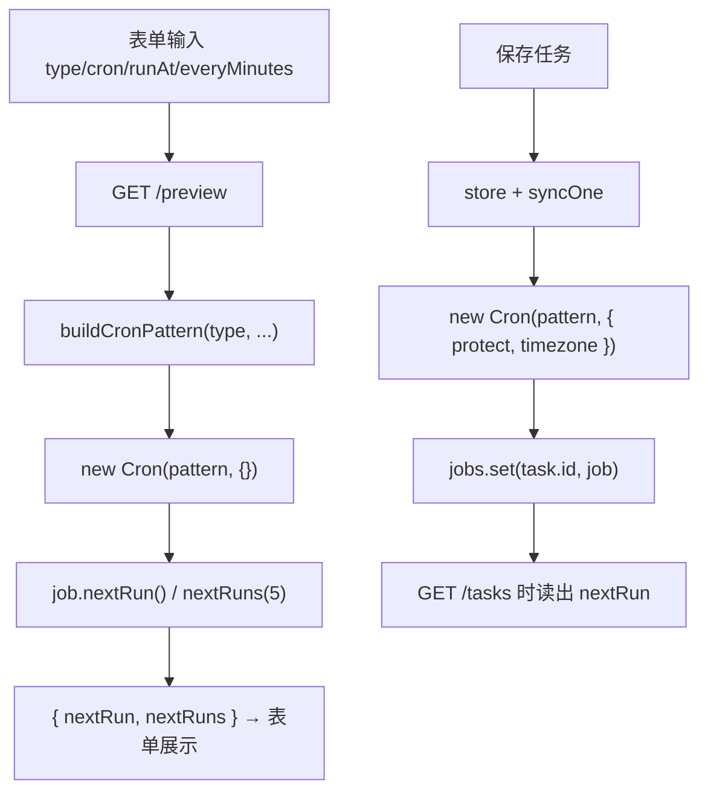
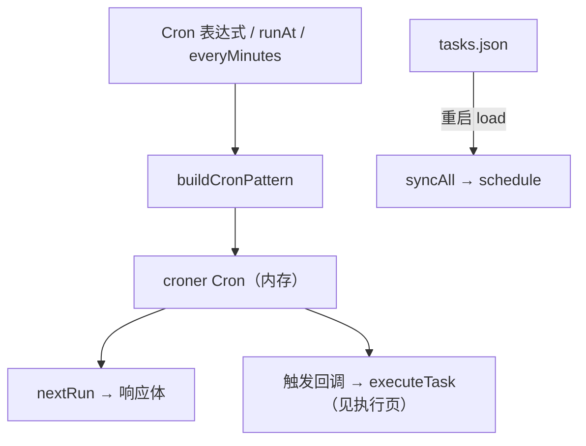

<details><summary>Relevant source files</summary>

- [src/routes.ts](src/routes.ts)
- [src/scheduler.ts](src/scheduler.ts)
- [src/types.ts](src/types.ts)
- [src/index.ts](src/index.ts)
- [src/client/SchedulerPanel.tsx](src/client/SchedulerPanel.tsx)

</details>

> 挖掘批次：2026-10-24 系统功能挖掘（wiki-capability）。本页聚焦「时间面」：三种触发类型如何编译成 croner pattern、预览路由怎么算、`nextRun` 从哪里来、时区在哪里生效。

## 1. 概念定义

### 1.1 核心概念

| 概念 | 定义 | 为什么重要 |
|---|---|---|
| **触发三型** | `type: 'cron' | 'once' | 'interval'`，各自只允许一个触发字段：`cron` / `runAt` / `everyMinutes`（`src/types.ts:190-192`） | 类型决定了 pattern 的编译方式与校验分支 |
| **buildCronPattern** | 唯一的 pattern 编译点：once → `Date`，interval → `*/N * * * *`，cron → 原样（`src/scheduler.ts:15-19`） | 实调度与预览共用它，是「预览可信度」的边界 |
| **nextRun** | 下一次触发的 ISO 时间；来源是 `job.nextRun()`，只对内存中的 job 有效（`src/scheduler.ts:58-60`） | 任务停用/未排期时为 `null`，列表与表单都靠它表达「下次何时跑」 |
| **草稿预览** | `/dsh-scheduler/preview` 用临时 Cron 计算 nextRun/nextRuns，不注册 job（`src/routes.ts:89-97`） | 预览失败或时区不一致时，用户看到的不是实际触发时间 |

### 1.2 领域概念

| 术语 | 说明 |
|---|---|
| `protect` | 交给 croner 的选项，用于抑制同 job 重叠触发；其有效性见 [[croner-protect-与非重入触发]] |
| `timezone` | 插件 Config 的 IANA 时区；缺省不传，croner 用系统本地时区（`src/scheduler.ts:24-29`） |
| `CRON_RE` | 前端用于即时提示的宽松正则，只判断「像不像 cron」，不负责最终校验（`src/client/SchedulerPanel.tsx:31`） |
| `nextRuns(5)` | 预览额外返回的最近 5 次时间，用于「校验」按钮的下拉列表 |

## 2. 系统事实

### 2.1 系统事实

| 事实 | 值 | 来源 |
|---|---|---|
| 预览入口 | `GET /dsh-scheduler/preview`，`type` 缺省为 `cron` | `src/routes.ts:81-85` |
| 预览返回 | `{ nextRun: string | null, nextRuns: string[] }`，最多 5 条 | `src/routes.ts:96-97`、`src/routes.ts:102` |
| 预览的时区 | **不传 timezone**（`new Cron(pattern, {})`），按系统本地时区求值 | `src/routes.ts:95` |
| 实调度的时区 | 传 `{ protect: true, timezone? }` | `src/scheduler.ts:36-42` |
| 列表里的 nextRun | 仅 enabled 任务返回，否则 `null` | `src/routes.ts:134-137` |
| 写请求响应里的 nextRun | `withNextRun` 统一拼装 | `src/routes.ts:251-256` |
| interval 编译 | `*/${everyMinutes} * * * *`（分钟步进） | `src/scheduler.ts:17` |
| once 编译 | `new Date(task.runAt)` | `src/scheduler.ts:16` |

> **推导（静态）**：配置了非系统时区时，表单预览/「校验」列表按系统时区算，实际触发按配置时区算——两者可能相差数小时。这是同一任务「预览下次 09:00，实际 17:00 才跑」类问题的候选解释，需按部署配置确认。

### 2.2 数据事实

| 数据 | 位置 / 形态 |
|---|---|
| job 表 | `TaskScheduler.jobs`：`Map<string, Cron>`，纯内存，重启重排 | 
| 表单草稿 | React state：`type`/`cron`/`runAt`/`everyMinutes`/`nextRun`/`upcoming`（`src/client/SchedulerPanel.tsx:154-180`） |
| 下次执行展示 | 列表 `task.nextRun`；表单 `triggerValid && nextRun !== null` 才显示（`src/client/SchedulerPanel.tsx:719-722`） |
| 最近 5 次 | `upcoming` state，来自「校验」按钮的 `nextRuns`（`src/client/SchedulerPanel.tsx:446-456`、`src/client/SchedulerPanel.tsx:596-603`） |

## 3. 功能树与入口映射

### 3.1 功能模块结构

```
触发计划与下次执行
├─ 预览路由（草稿态） src/routes.ts
│  └─ GET /dsh-scheduler/preview → buildCronPattern → new Cron（临时）→ nextRun/nextRuns
├─ 排期内核 src/scheduler.ts
│  ├─ buildCronPattern    ← 三型 → croner pattern
│  ├─ schedule / unschedule ← Map 增删 + protect + timezone
│  └─ nextRun             ← job.nextRun()
└─ 前端表单/列表 src/client/SchedulerPanel.tsx
   ├─ 输入时 debounce 预览（previewSchedule）
   ├─ 「校验」按钮 → nextRuns(5) 列表
   └─ 列表行 triggerText / nextRun 展示
```

### 3.2 入口映射表

| 入口 | 类型 | 必填 | 内核 | 文件:行 |
|---|---|---|---|---|
| `GET /dsh-scheduler/preview` | route | `type`（缺省 cron）+ 对应触发字段 | `buildCronPattern` → 临时 `Cron` → `nextRun`/`nextRuns` | `src/routes.ts:81-104` |
| `GET /dsh-scheduler/tasks`（`nextRun` 字段） | route | — | `scheduler.nextRun(task.id)` | `src/routes.ts:133-139` |
| `POST /tasks`、`PUT /tasks/:id`、`/toggle`（排期副作用） | route | — | `syncOne` → `schedule`/`unschedule` | `src/routes.ts:69-72` |
| 表单实时预览 | ui | 触发字段 | `api.previewSchedule` | `src/client/SchedulerPanel.tsx:258-280` |
| 「校验」按钮 | ui | cron | `previewSchedule({type:'cron'})` → `nextRuns` | `src/client/SchedulerPanel.tsx:446-456` |

### 3.3 使用场景

| 场景 | 入口 | 理由 |
|---|---|---|
| 用户正在填表，想看「下次几点跑」 | 预览路由 | 不落库、不排期，草稿态专用 |
| 想确认 cron 写法对不对 | 「校验」按钮 | 比即时提示的正则更准，还给出最近 5 次 |
| 任务列表显示下次执行 | `GET /tasks` 的 `nextRun` | 只有已排期（enabled）的 job 才有值 |
| 停用任务后为什么没有下次执行 | `/toggle` → `syncOne` | unschedule 后 `nextRun()` 返回 null |

## 4. 调用链路总结

### 4.1 主链路图



### 4.2 分通道详细流程

```
预览通道（草稿态，无副作用）
  1. 读 type（缺省 cron）、cron、runAt、everyMinutes（src/routes.ts:82-85）
  2. 非 once/interval 的 type 归一成 cron（src/routes.ts:90）
  3. buildCronPattern 编译；once 传 Date、interval 传 `*/N * * * *`、cron 原样（src/scheduler.ts:15-19）
  4. new Cron(pattern, {}) 只取 nextRun 与 nextRuns(5)（src/routes.ts:95-97）
  5. 任何异常都吞成 { nextRun: null, nextRuns: [] }，HTTP 仍是 200（src/routes.ts:98-101）

排期通道（有副作用，只在写路由里发生）
  1. 写路由校验通过后调用 syncOne(task)（src/routes.ts:69-72）
  2. syncOne 先 unschedule（停旧 job），再按 enabled 决定是否 schedule
  3. schedule 用 { protect: true, timezone? } 建 job 并写入 Map（src/scheduler.ts:32-48）
  4. 响应时 withNextRun 从 job 读 nextRun（src/routes.ts:251-256）

展示通道
  1. GET /tasks 对每条任务取 scheduler.nextRun（src/routes.ts:134-137）
  2. 列表用 triggerText 描述触发方式（src/client/SchedulerPanel.tsx:885-889）
  3. 表单只显示「触发配置合法且 nextRun 非空」的下次执行（src/client/SchedulerPanel.tsx:719-722）
```

### 4.3 数据与存储关系



## 5. 附录

### 5.1 术语表

| 术语 | 含义 |
|---|---|
| 草稿态预览 | 不依赖已保存任务的预览：参数全从 query string 来 |
| `upcoming` | 「校验」按钮返回的最近 5 次执行时间列表 |
| `triggerValid` | 前端对触发字段的即时合法性判断（`src/client/SchedulerPanel.tsx:438`） |
| `triggerText` | 列表行的触发描述：once 带时间、interval 带分钟数、cron 直接显示表达式（`src/client/SchedulerPanel.tsx:885-889`） |

### 5.2 参考资料

- [[croner-protect-与非重入触发]] — protect/timezone 的语义与「保存成功但不触发」的成因
- [[capability-任务定义与持久化]] — `syncOne` 的上游：创建/编辑/删除任务时何时重排

## 任务问法

```queries
触发计划与下次执行是怎么实现的
预览的下次执行时间为什么和实际触发不一样
nextRun 是怎么算出来的
cron 表达式在哪里校验，支持秒级吗
修改触发时间要动哪些地方
新增一种触发类型要改哪些文件
```

## Sources

- `src/scheduler.ts:15-19`（`buildCronPattern` 三型编译）
- `src/scheduler.ts:32-48`（`schedule` 的 `protect` 与 timezone 选项）
- `src/scheduler.ts:58-60`（`nextRun` 读 job）
- `src/routes.ts:81-104`（预览路由的 `buildCronPattern` 与 `nextRuns`）
- `src/routes.ts:133-139`（列表里的 `nextRun`）
- `src/routes.ts:251-256`（`withNextRun` 统一拼装）
- `src/client/SchedulerPanel.tsx:258-280`（表单实时 `previewSchedule`）
- `src/client/SchedulerPanel.tsx:437-456`（`CRON_RE` 与「校验」按钮）
- `src/types.ts:190-192`（`effectiveType` 归一化）

```sources
[
  {
    "path": "src/scheduler.ts",
    "hash": "sha256:da7e59a381cc42cc",
    "symbols": [
      "buildCronPattern",
      "TaskScheduler",
      "nextRun"
    ]
  },
  {
    "path": "src/routes.ts",
    "hash": "sha256:a68da25aa3b41011",
    "symbols": [
      "mountSchedulerRoutes",
      "buildCronPattern",
      "nextRuns",
      "withNextRun"
    ]
  },
  {
    "path": "src/types.ts",
    "hash": "sha256:d99ba0a7969549d8",
    "symbols": [
      "effectiveType",
      "validateTask"
    ]
  },
  {
    "path": "src/client/SchedulerPanel.tsx",
    "hash": "sha256:e509e15f1230ea65",
    "symbols": [
      "previewSchedule",
      "CRON_RE",
      "triggerText"
    ]
  },
  {
    "path": "src/index.ts",
    "hash": "sha256:fa30cb84eaed8e50",
    "symbols": [
      "Config",
      "TaskScheduler"
    ]
  }
]
```
