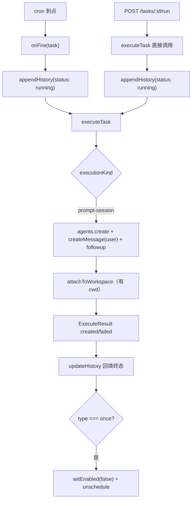
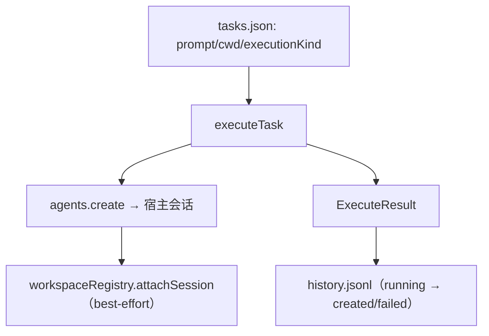

<details><summary>Relevant source files</summary>

- [src/executor.ts](src/executor.ts)
- [src/routes.ts](src/routes.ts)
- [src/types.ts](src/types.ts)
- [test/scheduled-session.test.mjs](test/scheduled-session.test.mjs)
- [test/executor-model-selection.test.mjs](test/executor-model-selection.test.mjs)

</details>

> 挖掘批次：2026-10-24 系统功能挖掘（wiki-capability）。本页只覆盖 `executionKind = prompt-session` 这条通道；工作流通道见 [[capability-附件与工作流联动]]。

## 1. 概念定义

### 1.1 核心概念

| 概念 | 定义 | 为什么重要 |
|---|---|---|
| **onFire** | 路由层注册给调度器的触发回调：先写一条 `running` 历史，再 `executeTask`，最后回填终态（`src/routes.ts:42-59`） | cron 触发与「立即执行」的差异都在这里 |
| **executeTask** | 执行内核：按 `executionKind` 分两条通道（`src/executor.ts:115-218`） | 提示词通道在本页；它不判重、不重试、不等待模型答完 |
| **ExecuteResult** | `{ status: 'created' | 'failed', sessionId?, workflowTaskId?, ms, error? }`（`src/executor.ts:15-21`） | 历史落库的终态来源；`created` 表示「会话已创建」，不是「回答已完成」 |
| **agentPreset** | 新会话使用的宿主 agent 预设；缺省会让会话没有标准工具（见 [[dsh-会话创建-agentpreset-与模型选择]]） | 没传 preset 的定时会话「看起来能跑，其实没有 skill/read/write」 |
| **followup** | `agent.followup(message)`：把提示词作为首条用户消息投递并唤醒 driver（`src/executor.ts:200`） | 这是「会话真的开始跑」的时刻；`executeTask` 在此之后立即返回 |

### 1.2 领域概念

| 术语 | 说明 |
|---|---|
| `ExecutionKind` | `'prompt-session' | 'knj-workflow'`，缺省归一化为 prompt-session（`src/types.ts:15`、`src/types.ts:96-98`） |
| `sessionId` | `randomUUID()` 生成的会话 id，同时是 `agent.id`（`src/executor.ts:167`、`src/executor.ts:201`） |
| `cwd` | 会话工作目录：任务设了就用任务的，否则用 `process.cwd()`（`src/executor.ts:183`） |
| `MessageSource` | 消息来源；提示词按 `{ kind: 'user' }` 投递，否则会话没有标题（`src/executor.ts:198`） |

## 2. 系统事实

### 2.1 系统事实

| 事实 | 值 | 来源 |
|---|---|---|
| 提示词来源 | 任务的 `prompt` 字段，创建时 `trim()` 后持久化 | `src/store.ts:103` |
| 会话 id | `randomUUID() as SessionId` | `src/executor.ts:167` |
| 宿主依赖 | `ctx.get('agents')`，缺 `create` 直接失败 | `src/executor.ts:159-166` |
| 失败语义 | 任何异常都收敛成 `{status:'failed', error}`，不向路由层抛 | `src/executor.ts:211-217` |
| 历史终态 | `created` / `failed`；`ms` = Date.now() 差值 | `src/executor.ts:157`、`src/executor.ts:210` |
| 防重入 | 执行层**没有**判重；cron 之间交给 croner `protect`，手动 run 完全绕过 | `src/executor.ts:115-218`、`src/routes.ts:172-189` |
| 工作区挂载 | 任务带 `cwd` 时 best-effort `attachSession`，失败只打日志 | `src/executor.ts:207-209`、`src/executor.ts:230-240` |

### 2.2 数据事实

| 数据 | 位置 / 形态 |
|---|---|
| 执行结果 | 不落库；只把 `status/sessionId/ms/error` 回填进 history.jsonl 的那一行（`src/routes.ts:45-53`） |
| 会话本身 | 由宿主 agents 服务持有；调度器只存 `sessionId` |
| 用户提示词 | 持久化在 `tasks.json` 的 `prompt` 字段；**不写入** history（README「安全」节） |
| 手动执行响应 | `{ ok: true, result: ExecuteResult }`，同步返回（`src/routes.ts:187`） |

## 3. 功能树与入口映射

### 3.1 功能模块结构

```
到点执行与提示词会话
├─ 触发层 src/routes.ts
│  ├─ onFire（cron 到点）
│  └─ POST /tasks/:id/run（立即执行，绕过调度器）
├─ 执行内核 src/executor.ts
│  ├─ executeTask → 分支：executionKind
│  ├─ defaultAgentPreset     ← 宿主预设三级回退
│  ├─ agents.create（meta.cwd + preset + setup 模型选择）
│  ├─ createMessage(source:user) → agent.followup
│  └─ attachToWorkspace（带 cwd 时）
└─ 证据 test/
   ├─ scheduled-session.test.mjs        ← preset + user source
   └─ executor-model-selection.test.mjs ← 模型选择 + volatile ref
```

### 3.2 入口映射表

| 入口 | 类型 | 必填 | 内核 | 文件:行 |
|---|---|---|---|---|
| cron 到点（无 HTTP 入口） | hook | — | `onFire` → `executeTask` | `src/routes.ts:42-59` |
| `POST /dsh-scheduler/tasks/:id/run` | route | 任务 id | 直接 `executeTask`（无 history 的 running 之外的调度语义） | `src/routes.ts:172-189` |
| `executeTask(ctx, task)` | internal | `executionKind` | 分通道执行 | `src/executor.ts:115-218` |

### 3.3 使用场景

| 场景 | 入口 | 理由 |
|---|---|---|
| 到点自动新建会话 | cron 回调 → `onFire` | 唯一写 `running` 再回填终态的地方 |
| 想马上验证一条任务 | `/tasks/:id/run` | 同步返回 `ExecuteResult`，能看到失败原因 |
| 想看产出会话 | 历史行的「打开会话」 | 历史里存了 `sessionId`，见执行历史页 |

## 4. 调用链路总结

### 4.1 主链路图



### 4.2 分通道详细流程

```
cron 触发通道
  1. 调度器回调 onFire(task)（src/routes.ts:42）
  2. appendHistory({taskId, at, status:'running'}) → 拿到 entry id（src/routes.ts:43）
  3. await executeTask(ctx, task, attachments)（src/routes.ts:44）
  4. updateHistory(id, {status, sessionId, workflowTaskId, ms, error})（src/routes.ts:45-53）
  5. type === 'once' → setEnabled(false) + unschedule（src/routes.ts:54-58）

立即执行通道
  1. sameOrigin 校验 → 404 检查任务存在（src/routes.ts:173-175）
  2. appendHistory(status:'running')（src/routes.ts:176）
  3. await executeTask(...)（src/routes.ts:177）
  4. updateHistory 回填 → 200 {ok:true, result}（src/routes.ts:178-187）
  注意：它不改 enabled、不撤 job、不检查该任务是否已在跑。

executeTask 的 prompt-session 分支
  1. ctx.get('agents')，没有 create → failed「宿主 agents 服务不可用」（src/executor.ts:159-166）
  2. sessionId = randomUUID()（src/executor.ts:167）
  3. agentPreset = defaultAgentPreset(ctx)（src/executor.ts:168）
  4. defaultModel = agentDefaultModel.currentSelection()（src/executor.ts:175）
  5. agents.create({ sessionId, meta:{cwd: task.cwd ?? process.cwd()}, agentPreset?, setup? }）（src/executor.ts:176-190）
  6. createMessage({role:'user', content:[text], source:{kind:'user'}})（src/executor.ts:191-199）
  7. agent.followup(message) 唤醒 driver（src/executor.ts:200）
  8. task.cwd 存在 → attachToWorkspace（src/executor.ts:207-209）
  9. 返回 { status:'created', sessionId, ms }（src/executor.ts:210）
```

### 4.3 数据与存储关系



## 5. 附录

### 5.1 术语表

| 术语 | 含义 |
|---|---|
| `created` | 会话/流程任务已创建；不代表 LLM 已答完 |
| `ms` | `executeTask` 耗时（毫秒），不含模型回答时间 |
| driver | 宿主 agent 的驱动器；`followup` 唤醒它开始一轮 |
| 无 HTTP 入口的触发 | cron 回调不经过任何路由，`/run` 才是 HTTP 入口 |

### 5.2 参考资料

- [[dsh-会话创建-agentpreset-与模型选择]] — 四个坑的完整证据链（回归测试逐条对应）
- [[croner-protect-与非重入触发]] — 为什么 cron 之间可能重叠、手动执行为何绕过
- [[capability-触发计划与下次执行]] — 上游：谁在什么时刻调用 onFire

## 任务问法

```queries
到点执行与提示词会话是怎么实现的
定时任务到点后怎么新建会话
为什么到点执行的会话没有 skill 工具
立即执行和 cron 触发有什么区别
改执行链路要动哪些地方
新增一种执行类型要改哪些文件
```

## Sources

- `src/executor.ts:101-113`（`defaultAgentPreset` 三级回退）
- `src/executor.ts:159-200`（`agents.create`、`createMessage`、`followup`）
- `src/executor.ts:115-218`（`executeTask` 分支与错误收敛）
- `src/executor.ts:230-240`（`attachToWorkspace` 吞错）
- `src/routes.ts:42-59`（`onFire`：`appendHistory` → `executeTask` → `updateHistory`）
- `src/routes.ts:172-189`（`runMatch` 立即执行）
- `test/scheduled-session.test.mjs:38-48`（`agentPreset` 与 user `source` 断言）
- `test/executor-model-selection.test.mjs:110-131`（带 preset 仍须传 `setup`）

```sources
[
  {
    "path": "src/executor.ts",
    "hash": "sha256:7e1b374ad982d35b",
    "symbols": [
      "executeTask",
      "defaultAgentPreset",
      "createMessage",
      "attachToWorkspace"
    ]
  },
  {
    "path": "src/routes.ts",
    "hash": "sha256:a68da25aa3b41011",
    "symbols": [
      "onFire",
      "executeTask",
      "updateHistory",
      "runMatch"
    ]
  },
  {
    "path": "src/types.ts",
    "hash": "sha256:d99ba0a7969549d8",
    "symbols": [
      "ExecutionKind",
      "TaskDef"
    ]
  },
  {
    "path": "test/scheduled-session.test.mjs",
    "hash": "sha256:3ec36801aee2e8ab",
    "symbols": [
      "agentPreset",
      "agentPresets"
    ]
  },
  {
    "path": "test/executor-model-selection.test.mjs",
    "hash": "sha256:70a7c452fe60f3cd",
    "symbols": [
      "installModelSelection",
      "agentPreset"
    ]
  }
]
```
