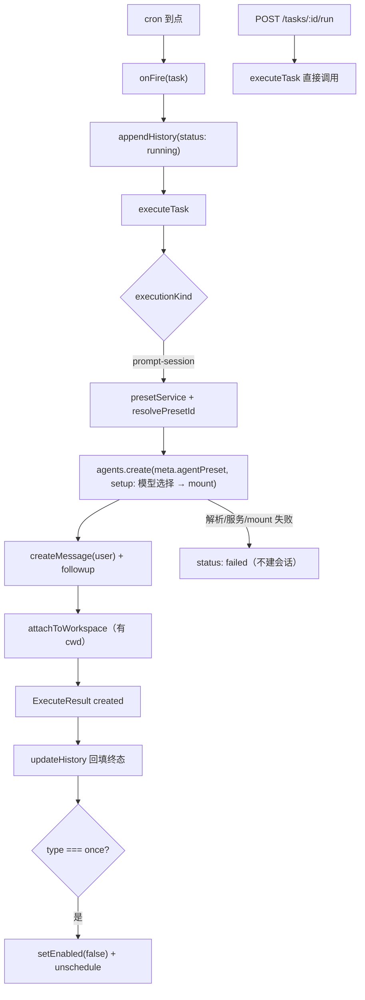
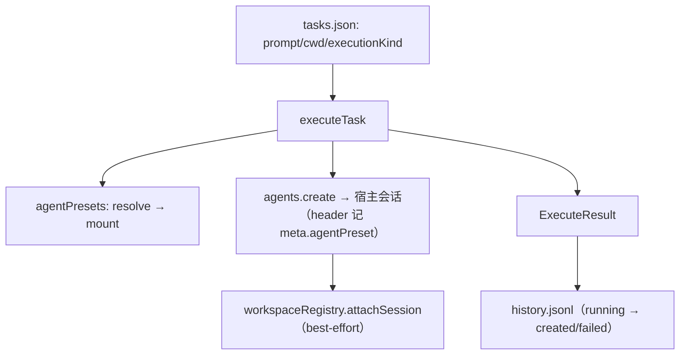

> 挖掘批次：2026-10-24 系统功能挖掘（wiki-capability）。本页只覆盖 `executionKind = prompt-session` 这条通道；工作流通道见 [[capability-附件与工作流联动]]。2026-10-24 根据实测复核过一次 preset 挂载链路。

## 1. 概念定义

### 1.1 核心概念

| 概念 | 定义 | 为什么重要 |
|---|---|---|
| **onFire** | 路由层注册给调度器的触发回调：先写一条 `running` 历史，再 `executeTask`，最后回填终态（`src/routes.ts:42-59`） | cron 触发与「立即执行」的差异都在这里 |
| **executeTask** | 执行内核：按 `executionKind` 分两条通道（`src/executor.ts:182-293`） | 提示词通道在本页；它不判重、不重试、不等待模型答完 |
| **ExecuteResult** | `{ status: 'created' | 'failed', sessionId?, workflowTaskId?, ms, error? }`（`src/executor.ts:15-21`） | 历史落库的终态来源；`created` 表示「会话已创建」，不是「回答已完成」 |
| **agentPreset 挂载** | 宿主 preset 服务的三步：`resolve(id)` → 写 `meta.agentPreset` → `setup` 里 `mount(agentCtx, id)`（见 [[dsh-会话创建-agentpreset-与模型选择]]） | 不挂 preset 的会话「创建成功但没有任何标准工具」：没有 `skill`、没有 read/write/pwsh |
| **followup** | `agent.followup(message)`：把提示词作为首条用户消息投递并唤醒 driver（`src/executor.ts:275`） | 这是「会话真的开始跑」的时刻；`executeTask` 在此之后立即返回 |

### 1.2 领域概念

| 术语 | 说明 |
|---|---|
| `ExecutionKind` | `'prompt-session' | 'knj-workflow'`，缺省归一化为 prompt-session（`src/types.ts:15`、`src/types.ts:96-98`） |
| `sessionId` | `randomUUID()` 生成的会话 id，同时是 `agent.id`（`src/executor.ts:234`、`src/executor.ts:276`） |
| `cwd` | 会话工作目录：任务设了就用任务的，否则用 `process.cwd()`（`src/executor.ts:256`） |
| `MessageSource` | 消息来源；提示词按 `{ kind: 'user' }` 投递，否则会话没有标题（`src/executor.ts:273`） |
| `PresetServiceLike` | 宿主 preset 服务的结构子集（`resolve`/`mount`）：0.1.x 是 `dsh-agent-presets`，0.2.x 是 `dsh-agent-preset-registry`（`src/executor.ts:78-88`） |

## 2. 系统事实

### 2.1 系统事实

| 事实 | 值 | 来源 |
|---|---|---|
| 提示词来源 | 任务的 `prompt` 字段，创建时 `trim()` 后持久化 | `src/store.ts:103` |
| 会话 id | `randomUUID() as SessionId` | `src/executor.ts:234` |
| 宿主依赖 | `ctx.get('agents')`，缺 `create` 直接失败；`ctx.get('agentPresets')` 缺 `resolve/mount` 也失败 | `src/executor.ts:226-233`、`src/executor.ts:145-159` |
| preset 解析 | 创建会话**前** `resolvePresetId(presets, defaultAgentPreset(ctx))` | `src/executor.ts:242-243` |
| preset 挂载 | `setup` 内先装模型选择、再 `presets.mount(agentCtx, presetId)` | `src/executor.ts:259-264` |
| 失败语义 | 任何异常都收敛成 `{status:'failed', error}`；preset 解析不到 / 缺服务 / mount 失败都不建会话 | `src/executor.ts:286-293`、`src/executor.ts:145-180` |
| 历史终态 | `created` / `failed`；`ms` = Date.now() 差值 | `src/executor.ts:224`、`src/executor.ts:285` |
| 防重入 | 执行层**没有**判重；cron 之间交给 croner `protect`，手动 run 完全绕过 | `src/executor.ts:182-293`、`src/routes.ts:172-189` |
| 工作区挂载 | 任务带 `cwd` 时 best-effort `attachSession`，失败只打日志 | `src/executor.ts:282-283`、`src/executor.ts:305-315` |

### 2.2 数据事实

| 数据 | 位置 / 形态 |
|---|---|
| 执行结果 | 不落库；只把 `status/sessionId/ms/error` 回填进 history.jsonl 的那一行（`src/routes.ts:45-53`） |
| 会话本身 | 由宿主 agents 服务持有；调度器只存 `sessionId` |
| 用户提示词 | 持久化在 `tasks.json` 的 `prompt` 字段；**不写入** history（README「安全」节） |
| 手动执行响应 | `{ ok: true, result: ExecuteResult }`，同步返回（`src/routes.ts:187`） |

## 3. 功能树与入口映射

### 3.1 功能模块结构

```
到点执行与提示词会话
├─ 触发层 src/routes.ts
│  ├─ onFire（cron 到点）
│  └─ POST /tasks/:id/run（立即执行，绕过调度器）
├─ 执行内核 src/executor.ts
│  ├─ executeTask → 分支：executionKind
│  ├─ presetService      ← 缺 resolve/mount 直接失败
│  ├─ defaultAgentPreset ← 宿主预设三级回退（defaultId → volatile 解包 → config.default）
│  ├─ resolvePresetId    ← 创建前解析，失败点名 preset
│  ├─ agents.create（meta.cwd + meta.agentPreset + setup：模型选择 → mount）
│  ├─ createMessage(source:user) → agent.followup
│  └─ attachToWorkspace（带 cwd 时）
└─ 证据 test/
   ├─ executor-preset-mount.test.mjs     ← resolve/meta/mount + 三种失败语义
   ├─ scheduled-session.test.mjs         ← resolve/mount + user source
   └─ executor-model-selection.test.mjs  ← 模型选择 + volatile ref
```

### 3.2 入口映射表

| 入口 | 类型 | 必填 | 内核 | 文件:行 |
|---|---|---|---|---|
| cron 到点（无 HTTP 入口） | hook | — | `onFire` → `executeTask` | `src/routes.ts:42-59` |
| `POST /dsh-scheduler/tasks/:id/run` | route | 任务 id | 直接 `executeTask`（无调度语义） | `src/routes.ts:172-189` |
| `executeTask(ctx, task)` | internal | `executionKind` | 分通道执行 | `src/executor.ts:182-293` |

## 4. 调用链路总结

### 4.1 主链路图



### 4.2 分通道详细流程

```
cron 触发通道
  1. 调度器回调 onFire(task)（src/routes.ts:42）
  2. appendHistory({taskId, at, status:'running'}) → 拿到 entry id（src/routes.ts:43）
  3. await executeTask(ctx, task, attachments)（src/routes.ts:44）
  4. updateHistory(id, {status, sessionId, workflowTaskId, ms, error})（src/routes.ts:45-53）
  5. type === 'once' → setEnabled(false) + unschedule（src/routes.ts:54-58）

executeTask 的 prompt-session 分支
  1. ctx.get('agents')，没有 create → failed「宿主 agents 服务不可用」（src/executor.ts:226-233）
  2. sessionId = randomUUID()（src/executor.ts:234）
  3. presets = presetService(ctx)：缺 resolve/mount → failed（src/executor.ts:242、145-159）
  4. presetId = await resolvePresetId(presets, defaultAgentPreset(ctx))（src/executor.ts:243、170-180）
  5. defaultModel = agentDefaultModel.currentSelection()（src/executor.ts:248）
  6. agents.create({ sessionId, meta:{cwd, agentPreset: presetId}, setup }):
       setup = agentCtx => { installModelSelection?; presets.mount(agentCtx, presetId) }（src/executor.ts:256-264）
  7. createMessage({role:'user', content:[text], source:{kind:'user'}})（src/executor.ts:266-273）
  8. agent.followup(message) 唤醒 driver（src/executor.ts:275）
  9. task.cwd 存在 → attachToWorkspace（src/executor.ts:282-283）
  10. 返回 { status:'created', sessionId, ms }（src/executor.ts:285）
```

### 4.3 数据与存储关系



## 5. 实测证据（2026-10-24）

- 修复前的构建（只传顶层 `agentPreset`）在本机 DSH 0.2.1-rc.2 上创建探针会话 `79d66ff4-3c31-4e76-8a9c-afa1041b9715`：header 无 `agentPreset`（projection `null`），模型可用工具只有宿主平面插件工具（`list_agents`、`working_directory`、`wiki_*`、`pilot_*`、`team_*`、`doublecheck_*`）；模型自述 `skill/read/pwsh/todo_write` 全 MISSING。
- `history.jsonl` 中旧会话 `010e8796`/`170ef1b6`/`372b7611`/`87257401`/`c132153d`/`6fe8637b` header 均 `preset: null`；`6fe8637b` 还因 `{{model}}` 无值而 prompt 组装失败（旧构建缺模型选择）。
- 对照：GUI 会话 header `preset: standard`，`skill` 调用正常；工作流通道的 `knj-task-*` 会话 header `preset: standard`（`dsh-knj-workflow` 一直按 resolve+mount 挂载）。
- 修复后：`node --test test/*.test.mjs` 25/25 通过，其中 `test/executor-preset-mount.test.mjs` 的六条行为断言覆盖挂载成功与解析/缺服务/mount 三种失败语义。
- **部署后活体验收（2026-10-24 23:50 重装、23:52 重启）**：同一探针任务新建会话 `72bd64e3-2e0c-4d33-b560-71a8c5e05274`，header `agentPreset = standard`；`tool/call` 实际调用 `skill`（加载 `tdd`）与 `read`（读 `package.json`）；模型逐行回答五个工具全 `AVAILABLE`；turn `completed`。探针任务已删除、`tasks.json` / `history.jsonl` 已还原。

## 6. 附录

### 6.1 术语表

| 术语 | 含义 |
|---|---|
| `created` | 会话/流程任务已创建；不代表 LLM 已答完 |
| `ms` | `executeTask` 耗时（毫秒），不含模型回答时间 |
| driver | 宿主 agent 的驱动器；`followup` 唤醒它开始一轮 |
| preset 挂载 | `agentPresets.mount(agentCtx, id)`：把 preset 的 tools/prompt/skill 装进 agent 隔离 scope |

### 6.2 参考资料

- [[dsh-会话创建-agentpreset-与模型选择]] — 四个坑的完整证据链与 2026-10-24 实测
- [[croner-protect-与非重入触发]] — 为什么 cron 之间可能重叠、手动执行为何绕过
- [[capability-触发计划与下次执行]] — 上游：谁在什么时刻调用 onFire

## 任务问法

```queries
到点执行与提示词会话是怎么实现的
定时任务到点后怎么新建会话
为什么到点执行的会话没有 skill 工具
定时任务会话能不能加载 skill
立即执行和 cron 触发有什么区别
改执行链路要动哪些地方
新增一种执行类型要改哪些文件
```

## Sources

- `src/executor.ts:145-180`（`presetService` / `resolvePresetId`）
- `src/executor.ts:226-285`（agents.create、meta.agentPreset、setup、createMessage、followup）
- `src/executor.ts:182-293`（executeTask 分支与错误收敛）
- `src/executor.ts:305-315`（attachToWorkspace 吞错）
- `src/routes.ts:42-59`（onFire）、`src/routes.ts:172-189`（立即执行）
- `test/executor-preset-mount.test.mjs:117-211`（挂载与三种失败语义）
- `test/scheduled-session.test.mjs`（resolve/mount 与 user source 守卫）
- `test/executor-model-selection.test.mjs`（模型选择不得以 preset 为条件）

